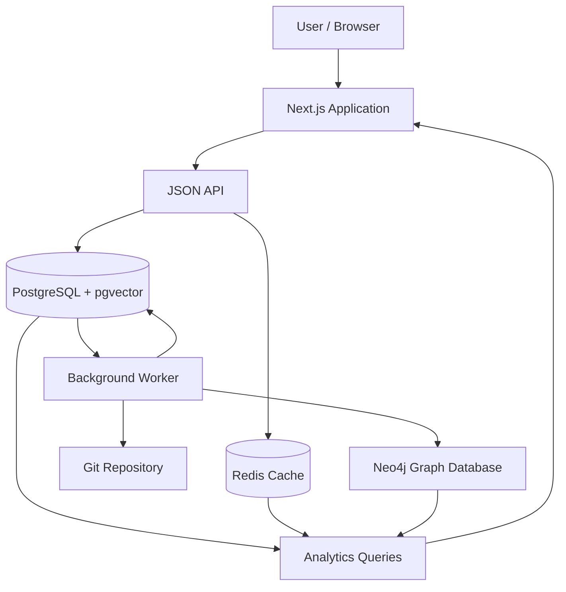

# Git Repository Forensics

<p align="center">
  <strong>A Database-Driven Git Repository Intelligence Platform</strong>
</p>

<p align="center">
  Analyze repository history, discover developer contributions, identify code hotspots, detect change coupling, and generate intelligent reviewer recommendations.
</p>

---

## Table of Contents

- [Overview](#overview)
- [Problem Statement](#problem-statement)
- [Objectives](#objectives)
- [Key Features](#key-features)
- [System Architecture](#system-architecture)
- [Technology Stack](#technology-stack)
- [Database Architecture](#database-architecture)
- [Core Analytics](#core-analytics)
- [System Workflow](#system-workflow)
- [Installation and Setup](#installation-and-setup)
- [Running the Application](#running-the-application)
- [Available Commands](#available-commands)
- [API Documentation](#api-documentation)
- [Security](#security)
- [Testing](#testing)
- [Project Structure](#project-structure)
- [Team Contributions](#team-contributions)
- [Limitations and Future Enhancements](#limitations-and-future-enhancements)

---

## Overview

Git Repository Forensics is a database-driven platform that extracts, processes, stores, and analyzes Git repository history to generate actionable insights into software development activities.

Traditional Git tools provide commit histories and file-level change information. However, understanding developer ownership, identifying risky files, discovering hidden relationships between files, and recommending reviewers requires deeper analysis.

This project transforms raw Git history into structured information using relational databases, graph databases, vector search, and caching mechanisms.

The platform enables development teams to understand:

- Who contributes to different parts of the codebase?
- Which files are most frequently modified?
- Which files tend to change together?
- How dependent is the project on individual developers?
- Who would be suitable to review a particular change?
- How can developers find commits based on keywords or similar descriptions?

**Project Type:** DBMS Experiential Learning – Level 3  
**Domain:** Database Management Systems, Software Analytics and Repository Mining

## Problem Statement

Software repositories contain large amounts of historical information, including commits, file modifications, authorship records, and code ownership information.

Although Git maintains this information, extracting meaningful insights from thousands of commits is difficult using conventional version-control commands.

The absence of integrated repository analytics creates challenges such as:

1. Difficulty identifying developers with expertise in specific files.
2. Limited visibility into frequently modified and potentially risky files.
3. Lack of awareness of dependencies between files that change together.
4. Difficulty identifying knowledge silos and contributor dependencies.
5. Inefficient reviewer selection during code review.
6. Difficulty retrieving historical commits based on their semantic context.

Git Repository Forensics addresses these challenges through a unified analytical platform backed by multiple database technologies.

## Objectives

- Extract complete repository history using Git.
- Store repository metadata in a normalized relational database.
- Analyze developer activity and file ownership.
- Identify code hotspots using change frequency, authorship, and churn.
- Detect change coupling between files.
- Calculate repository bus factor and contributor concentration.
- Generate reviewer recommendations using graph traversal.
- Support full-text and vector-based commit search.
- Provide an interactive dashboard for exploring repository analytics.
- Maintain data consistency through database constraints, transactions, and triggers.

## Key Features

### 1. Developer Contribution Analysis

Analyzes developer activity across the repository.

Metrics include:
- Total commits per developer.
- Files modified by each developer.
- Lines currently owned by each developer using `git blame`.
- Developer activity over time.
- Contribution distribution across the repository.

### 2. Code Hotspot Detection

Identifies files that may require additional maintenance and review.

The hotspot analysis considers:
- Number of revisions.
- Number of distinct contributors.
- Code churn.
- Frequency of modifications.

Frequently modified files with high contributor involvement can indicate areas of increased maintenance complexity.

### 3. Change Coupling Detection

Identifies files that repeatedly change together in the same commits.

The system calculates:
- Co-change frequency.
- Directional confidence.
- Jaccard similarity.

These relationships help identify hidden dependencies that may not be explicitly represented in the source code.

### 4. Code Ownership and Bus Factor

Uses Git blame information to determine how many lines of code each developer currently owns.

The bus factor estimates the minimum number of developers responsible for more than half of the currently owned lines.

This helps identify potential knowledge concentration and project continuity risks.

### 5. Intelligent Reviewer Recommendations

Uses a Neo4j graph to represent relationships between developers and files.

The system traverses developer-to-file and file-to-file relationships to identify developers who have relevant experience with files involved in a change.

### 6. Commit Search

Provides two approaches to searching repository history:

- **Full-text search:** Retrieves commits using PostgreSQL text-search capabilities.
- **Similarity search:** Uses pgvector to retrieve commits with similar message representations.

### 7. Team Analytics

Provides insights into:
- Core contributors.
- Shared files.
- Developer collaboration.
- Knowledge silos.
- Contribution distribution.

SQL aggregation, grouping, subqueries, and `HAVING` clauses are used to generate these reports.

### 8. Background Repository Analysis

Repository analysis runs asynchronously through a dedicated worker.

Users can:
- Register repositories.
- Queue analysis jobs.
- Monitor live job progress.
- Cancel active jobs.
- Trigger repository re-analysis.

---

## System Architecture

The application follows a multi-database architecture in which each technology handles a specific type of workload.



### Architecture Components

| Component | Responsibility |
|---|---|
| Next.js | User interface and application routing |
| JSON API | Handles application requests |
| PostgreSQL | Primary relational data storage |
| pgvector | Commit-message similarity search |
| Neo4j | Developer-file relationship graph |
| Redis | Caching, job progress and rate limiting |
| Background Worker | Repository mining and analysis |
| Git | Repository history extraction |

### Database Responsibilities

**PostgreSQL – Source of Truth**

Stores users, repositories, developers, commits, files, file changes, ownership information, analysis jobs and audit records.

**pgvector – Similarity Search**

Stores commit-message embeddings and enables nearest-neighbour searches.

**Neo4j – Graph Relationships**

Represents developer-file interactions and file coupling relationships.

**Redis – Temporary Storage**

Stores cached analytical reports, job progress and rate-limit counters with expiration times.

PostgreSQL remains the authoritative database. Neo4j is a rebuildable projection of relational data.

---

## Technology Stack

| Technology | Purpose |
|---|---|
| Next.js | Frontend and backend application |
| TypeScript | Application development |
| PostgreSQL 17 | Relational database |
| pgvector | Vector similarity search |
| Neo4j 5 | Graph database |
| Redis 6+ | Caching and temporary data |
| Git | Repository history extraction |
| Docker Compose | Database service orchestration |
| SQL | Database queries, procedures and triggers |
| Node.js 22+ | Runtime environment |

### Why These Technologies?

- **PostgreSQL:** Supports relational integrity, transactions, complex joins, aggregation, indexing, and advanced SQL functionality.
- **pgvector:** Enables vector similarity search without introducing a separate vector database.
- **Neo4j:** Makes multi-hop relationship traversal between developers and files easier to express.
- **Redis:** Provides fast access to frequently requested analytical results and live job information.
- **Next.js:** Supports server-rendered pages and API route handlers within one application.
- **Docker:** Simplifies local setup and management of the database services.

---

## Database Architecture

The project uses a normalized relational schema with 13 tables organized around repository metadata, developer activity, file modifications, ownership, and analysis management.

### Main Database Entities

| Entity | Description |
|---|---|
| users | User accounts and roles |
| sessions | Authentication sessions |
| repositories | Registered Git repositories |
| analysis_jobs | Background analysis jobs |
| developers | Repository contributors |
| commits | Commit metadata |
| files | Repository file paths |
| file_changes | Commit-to-file relationships |
| hunks | Changed line ranges |
| coupling_edges | Relationships between coupled files |
| file_ownership | Current code ownership |
| commit_embeddings | Vector representations of commit messages |
| audit_log | Application activity records |

### Database Concepts Implemented

**Normalization**

The relational schema separates developers, commits, files, and file changes to reduce unnecessary duplication and maintain consistency.

**Primary and Foreign Keys**

Relationships between repositories, developers, commits, and files are enforced using relational constraints.

**Check Constraints**

Ensure valid values, including correctly ordered file pairs in coupling relationships.

**Triggers**

Automate database operations, including:
- Protecting the last active administrator.
- Updating repository analysis timestamps when a job succeeds.

**Views**

The `file_hotspots` view derives hotspot metrics from stored repository history.

**Materialized Views**

The `monthly_activity` materialized view stores precomputed monthly activity analytics.

**Stored Functions**

The `bus_factor()` SQL function calculates the repository's bus factor using ownership information and window functions.

**Stored Procedures**

The `purge_expired_sessions()` procedure removes expired authentication sessions.

**Indexes**

The database uses:
- B-tree indexes.
- GIN indexes for full-text search.
- HNSW indexes for vector similarity.
- Unique and partial unique indexes.

### Schema Evolution

Database changes are managed through versioned SQL migrations.

- `001_schema.sql` establishes the initial database structure.
- `002_team_analytics.sql` introduces schema enhancements, generated columns, additional constraints, and team analytics improvements.

Applied migrations are tracked in `schema_migrations`.

---

## Core Analytics

### 1. Change Coupling

For two files A and B:

- `n(A)` = Number of commits modifying file A.
- `n(B)` = Number of commits modifying file B.
- `n(A,B)` = Number of commits modifying both files.

**Confidence A → B**

```text
Confidence(A → B) = n(A,B) / n(A)
```

Measures how frequently B changes whenever A changes.

**Jaccard Similarity**

```text
Jaccard(A,B) = n(A,B) / (n(A) + n(B) - n(A,B))
```

Measures the overall similarity between the change histories of two files.

The value ranges from 0 to 1.

A higher value indicates a stronger change relationship.

### 2. Bus Factor

The bus factor represents the minimum number of developers who collectively own more than 50% of the currently owned lines.

The calculation uses a cumulative window function:

```sql
SUM(lines_owned) OVER (
    ORDER BY lines_owned DESC
)
```

The result helps identify repositories where knowledge is concentrated among a small number of developers.

### 3. Hotspot Analysis

Hotspots are identified using three major dimensions:

- Revisions: How frequently a file changes.
- Authors: How many different developers modify it.
- Churn: How many lines are added and removed.

These metrics help prioritize files for maintenance and additional review.

### 4. Team Analytics

SQL aggregation identifies contributors and shared files.

Examples include:

- `GROUP BY` to aggregate developer activity.
- `HAVING` to filter contributors based on commit counts.
- Subqueries to calculate average contribution levels.
- Joins to connect developer and commit information.
- Window functions to calculate cumulative ownership.

---

## System Workflow

The repository analysis pipeline follows these steps:

1. **Repository Registration:** The user registers a Git repository through the application.
2. **Job Creation:** A repository record, analysis job, and audit record are created transactionally.
3. **Job Processing:** A background worker claims the job using PostgreSQL row locking and `SKIP LOCKED`.
4. **Git Mining:** The worker extracts commit metadata, file modifications, changed line ranges, and ownership information.
5. **Data Processing:** The system computes change coupling, analytics metrics, and commit embeddings.
6. **Database Storage:** Previous analysis results are replaced with new results in a transaction.
7. **Derived Data Refresh:** Materialized views are refreshed, Neo4j relationships are rebuilt, and relevant Redis cache entries are cleared.
8. **Report Generation:** Users access repository analytics through the Next.js dashboard.

---

## Installation and Setup

### Prerequisites

Ensure the following are installed:

- Node.js 22 or later.
- npm.
- Git 2.30 or later.
- Docker Desktop or Docker Engine.
- PostgreSQL 17 with pgvector, Neo4j 5 and Redis 6+ if using native services instead of Docker.

### Step 1: Clone the Repository

```bash
git clone https://github.com/krista9669/git-repository-forensics.git

cd git-repository-forensics
```

### Step 2: Install Dependencies

```bash
npm install
```

### Step 3: Configure Environment Variables

Create the local environment file:

```bash
cp .env.example .env.local
```

On Windows PowerShell:

```powershell
Copy-Item .env.example .env.local
```

Update the required environment variables, including database connection strings, Redis configuration, Neo4j credentials, and administrator credentials.

Replace all placeholder `CHANGE_ME` values.

### Step 4: Start Database Services

```bash
npm run db:up
```

This starts the PostgreSQL, Neo4j, and Redis services using Docker Compose.

### Step 5: Run Database Migrations

```bash
npm run db:migrate
```

### Step 6: Initialize Neo4j

```bash
npm run neo4j:init
```

### Step 7: Seed the Database

```bash
npm run db:seed -- --demo
```

This creates an administrator account and registers a demo repository for analysis.

---

## Running the Application

The application requires two separate processes.

**Terminal 1 – Background Worker**

```bash
npm run worker
```

The worker processes queued repository analysis jobs.

**Terminal 2 – Next.js Application**

```bash
npm run dev
```

Open the application:

```text
http://localhost:3000
```

Sign in using the administrator credentials configured in `.env.local`.

### Adding Repositories

The application supports:

- Remote public repositories from supported HTTPS Git hosting providers.
- Local repositories inside the configured `LOCAL_REPO_ROOT`.

Remote repositories are restricted to allow-listed hosts. Private repositories requiring authentication are not supported by the current implementation.

---

## Available Commands

| Command | Description |
|---|---|
| `npm run dev` | Start development server |
| `npm run build` | Build application |
| `npm run start` | Start production server |
| `npm run worker` | Start analysis worker |
| `npm run db:up` | Start database containers |
| `npm run db:down` | Stop database containers |
| `npm run db:migrate` | Apply migrations |
| `npm run db:reset` | Reset database |
| `npm run db:seed` | Seed administrator account |
| `npm run neo4j:init` | Initialize graph database |
| `npm run fixture` | Generate demo repository |
| `npm test` | Run all tests |
| `npm run typecheck` | Run TypeScript checks |

---

## API Documentation

All API endpoints require a valid session cookie except authentication endpoints.

### Authentication

| Method | Endpoint | Description |
|---|---|---|
| POST | `/api/auth/login` | Authenticate user |
| POST | `/api/auth/register` | Register user |
| POST | `/api/auth/logout` | End session |

### Repository Management

| Method | Endpoint | Description |
|---|---|---|
| GET | `/api/repositories` | Retrieve repositories |
| POST | `/api/repositories` | Register repository |
| GET | `/api/repositories/:id` | Retrieve repository details |
| DELETE | `/api/repositories/:id` | Delete repository |
| POST | `/api/repositories/:id/analyze` | Queue re-analysis |

### Analytics

```text
GET /api/repositories/:id/report?kind=summary
GET /api/repositories/:id/report?kind=monthly
GET /api/repositories/:id/report?kind=developers
GET /api/repositories/:id/report?kind=hotspots
GET /api/repositories/:id/report?kind=coupling
GET /api/repositories/:id/report?kind=commits
GET /api/repositories/:id/report?kind=similar
GET /api/repositories/:id/report?kind=collaboration
GET /api/repositories/:id/report?kind=silos
```

### Job Management

| Method | Endpoint | Description |
|---|---|---|
| GET | `/api/jobs/:id` | Retrieve job status and progress |
| POST | `/api/jobs/:id/cancel` | Cancel an active job |

### Administration

| Method | Endpoint | Description |
|---|---|---|
| PATCH | `/api/admin/users/:id` | Update user role or active status |

---

## Security

Security is implemented across the application, API, and database layers.

### Authentication

- Passwords are hashed using bcrypt with a cost factor of 12.
- Sessions use randomly generated 256-bit tokens.
- Only SHA-256 hashes of session tokens are stored.
- Authentication cookies use `HttpOnly` and `SameSite=Lax`.

### API Security

- Login and registration are rate-limited.
- Mutating requests undergo origin validation.
- SQL queries use bound parameters.
- Failed authentication attempts are recorded in the audit log.

### Repository Validation

- Remote repository URLs must use HTTPS.
- Only configured Git hosting providers are allowed.
- Credentials, IP literals, ports, and query strings are rejected.
- Git execution avoids shell interpolation.
- Local repository paths are validated against the configured root directory.
- Branch names undergo validation before being passed to Git.

---

## Testing

The project contains unit and integration tests.

### Unit Testing

Tests cover:

- Git output parsing.
- Repository URL validation.
- File path validation.
- Branch validation.
- Change-coupling algorithms.
- Commit embedding algorithms.

### Integration Testing

Tests validate:

- Complete repository analysis.
- Database persistence.
- Change-coupling calculations.
- Database constraints.
- Foreign-key relationships.
- Unique active analysis jobs.
- Administrator protection triggers.
- Cascading deletes.

Run the tests:

```bash
npm test
```

Run TypeScript validation:

```bash
npm run typecheck
```

Integration tests require an accessible test database and can be skipped when `TEST_DATABASE_URL` is unreachable.

---

## Project Structure

```text
git-repository-forensics/
│
├── app/
│   ├── api/
│   └── pages and application routes
│
├── components/
│   └── UI components, charts and forms
│
├── db/
│   └── migrations/
│
├── lib/
│   ├── git/
│   ├── analysis/
│   ├── graph/
│   ├── db.ts
│   ├── redis.ts
│   ├── neo4j.ts
│   ├── auth.ts
│   └── queries.ts
│
├── workers/
│   └── analysis-worker.ts
│
├── scripts/
│   ├── migrate
│   ├── seed
│   ├── reset
│   └── fixture-repo.ts
│
├── tests/
│   ├── unit/
│   └── integration/
│
├── docs/
│   └── database-design.md
│
├── db/
│   └── migrations/
│
├── docker-compose.yml
├── .env.example
├── package.json
└── README.md
```

---

## Team Contributions

### Krishitha Kankanala

**Database Design and Core Analysis**

- Designed the relational database schema and database constraints.
- Implemented Git execution and history parsing.
- Developed repository analysis and change-coupling algorithms.
- Implemented commit embedding generation.
- Developed the Neo4j graph projection.
- Implemented database, Redis, and Neo4j integrations.
- Developed authentication and database query functionality.

### Sarah Kazi

**Application Development and Schema Evolution**

- Developed the Next.js application interface.
- Implemented API route handlers.
- Developed background analysis workers.
- Implemented schema migration 002 and team analytics queries.
- Developed migration and seeding scripts.
- Implemented application tests and project documentation.

---

## Limitations and Future Enhancements

Although the system provides several repository analytics capabilities, there are opportunities for further improvement.

| Current Limitation | Proposed Enhancement |
|---|---|
| Embeddings use feature hashing | Integrate a sentence-embedding model for stronger semantic retrieval |
| Every analysis starts from scratch | Implement incremental repository analysis |
| Developer identity relies on email | Introduce identity merging across multiple email addresses |
| Bot detection uses regex | Integrate configurable bot identification |
| Historical metrics cover all commits | Introduce time-windowed analytics |
| Only public repositories are supported | Add secure private repository authentication |
| API and UI testing coverage can improve | Introduce API and browser-based end-to-end tests |
| Large result lists are capped | Implement keyset pagination |

### Future Scope

- Predictive identification of potentially risky code changes.
- More advanced developer expertise recommendations.
- Time-based contributor activity analysis.
- Integration with GitHub pull requests.
- Enhanced semantic commit search.
- Repository comparison across multiple projects.
- Interactive dependency and collaboration visualizations.

---

## Academic Context

This project was developed as part of the **Database Management Systems Experiential Learning – Level 3** coursework.

The project demonstrates practical applications of:

- Relational database design and normalization.
- SQL joins, subqueries, and aggregation.
- Constraints, triggers, stored functions, and procedures.
- Transactions and concurrency control.
- Indexing and query optimization.
- Materialized views.
- Graph database modelling.
- Vector similarity search.
- NoSQL caching.
- Database-backed application development.

---

## Authors

**Krishitha Kankanala**  
PES2UG24CS234

**Sarah Kazi**  
PES2UG24CS224

---

<p align="center">
  Built with PostgreSQL, Neo4j, Redis, pgvector and Next.js.
</p>
