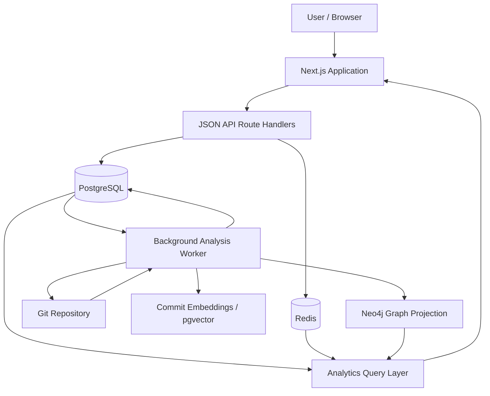

# System Architecture

## 1. Overview

Git Repository Forensics is a database-driven platform that mines Git repository history and turns it into repository intelligence. It combines a Next.js application, a background analysis worker, PostgreSQL, pgvector, Neo4j, and Redis.

The architecture separates the authoritative relational data from derived graph data and short-lived cache data.

## 2. High-Level Architecture

## 3. Main Components

### Next.js application

The Next.js application provides the user-facing interface and server-side application routes. Users can register repositories, view analysis progress, and explore repository reports.

### API route handlers

The API receives application requests, validates them, and coordinates database operations. Authentication is required for protected endpoints.

### PostgreSQL

PostgreSQL is the system's source of truth. It stores users, sessions, repositories, analysis jobs, developers, commits, files, file changes, changed-line hunks, coupling edges, file ownership, embeddings, and audit records.

### Background analysis worker

Repository mining is performed outside the web request lifecycle. The worker claims queued jobs from PostgreSQL, extracts Git history, computes analytical data, and persists the results.

The job-claiming query uses row locking with `FOR UPDATE SKIP LOCKED`, allowing multiple workers to claim different jobs without processing the same job concurrently.

### Git

Git commands are used to collect repository history. The documented extraction includes commit and file-change information, changed line ranges, and current line ownership.

### pgvector

Commit-message representations are stored alongside commit records in PostgreSQL. pgvector supports nearest-neighbour similarity search over those representations.

### Neo4j

Neo4j stores a graph projection of developer-file relationships and file-coupling relationships. It supports graph traversal for reviewer suggestions. PostgreSQL remains authoritative; the graph can be rebuilt from relational data.

### Redis

Redis stores short-lived data such as cached reports, job progress, and rate-limit counters. Cached report entries use a 10-minute TTL. Losing Redis affects performance or live progress visibility, not the authoritative repository records.

## 4. Repository Analysis Lifecycle

1. A user submits a repository for analysis.
2. The API validates the repository URL.
3. The application creates a repository record, queued job, and audit record in a transaction.
4. A worker claims the job using PostgreSQL row locking.
5. The worker mines commits and file changes using Git.
6. It collects changed-line ranges and line ownership information.
7. It computes change-coupling metrics and commit-message representations.
8. It replaces the previous analysis results and inserts the new results transactionally.
9. The monthly activity materialized view is refreshed.
10. The Neo4j graph projection is rebuilt from PostgreSQL.
11. Relevant Redis cache entries are cleared.
12. A database trigger updates the repository's `last_analyzed_at` timestamp when the job succeeds.
13. The user views reports through the application.

## 5. Transaction Boundaries and Consistency

The project uses transactions at important consistency boundaries:

- Repository registration creates the repository, job, and audit record together.
- Analysis-result replacement deletes old results and inserts new results in a transaction.
- Bulk inserts are performed in batches of 2,000 rows using `unnest`.
- A failed transaction rolls back, preventing readers from seeing a partially replaced analysis.

The graph database is rebuilt after the relational analysis is stored. It is a derived projection, not the primary record store.

## 6. Caching and Background Work

The worker keeps long-running repository mining out of the web request. PostgreSQL stores durable job state. Redis provides fast access to job progress and cached report responses.

The documented design uses a 10-minute TTL for expensive cached reports. Cache invalidation occurs after analysis results are refreshed.

## 7. Failure Considerations

| Component | Effect of failure | Recovery approach |
|---|---|---|
| PostgreSQL | Core application data and job processing unavailable | Restore database availability; it is the source of truth |
| Background worker | New jobs remain queued until a worker is available | Restart the worker |
| Redis | Cached reports and live progress become unavailable or slower | Restart Redis; rebuild cache from authoritative data |
| Neo4j | Graph-based reviewer functionality is affected | Rebuild graph projection from PostgreSQL |
| Git remote | Remote repository mining may fail | Retry analysis when the remote is reachable |
| Next.js application | Users cannot access the interface | Restart the application |

## 8. Architectural Rationale

The design uses each technology for a workload suited to it:

- Relational integrity and analytical SQL belong in PostgreSQL.
- Vector similarity is kept close to commit records through pgvector.
- Multi-hop relationship traversal is represented in Neo4j.
- Short-lived cache and progress data are held in Redis.
- Long-running mining runs in a background worker.

This keeps PostgreSQL as the authoritative store while allowing specialized components to support graph traversal, similarity search, and caching.
