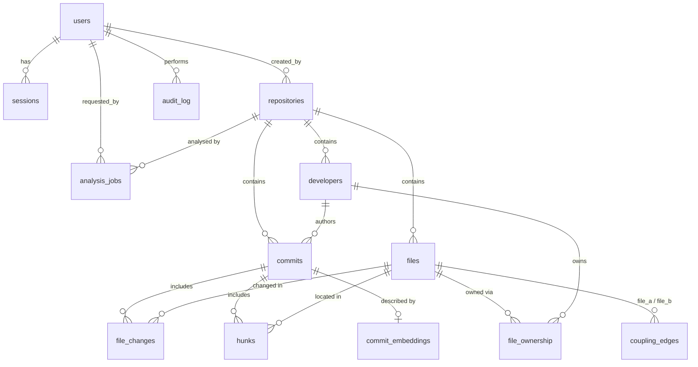

# Database design

PostgreSQL holds every authoritative fact. Neo4j and Redis hold only derived or short-lived data, and both can be rebuilt or emptied without losing anything. The DDL is in [`db/migrations`](../db/migrations): [`001_schema.sql`](../db/migrations/001_schema.sql) creates the schema and [`002_team_analytics.sql`](../db/migrations/002_team_analytics.sql) evolves it with `ALTER` / `DROP` (see [Schema evolution](#schema-evolution-migration-002)).

The full project report, with the attribute-level ER diagram, relational schema and data dictionary, is in [project-report.md](project-report.md).

## Entity–relationship model



## Tables

| Table | Key | Notes |
|---|---|---|
| `users` | `id` | Unique on `lower(email)` (expression index), e-mail format CHECK, `role` enum. |
| `sessions` | `token_hash` | Stores the SHA-256 of the cookie token, never the token itself. |
| `repositories` | `id` | `UNIQUE (source_type, source)`. CHECK that remote sources are `https://`. |
| `analysis_jobs` | `id` | The job queue. A partial unique index allows one queued or running job per repository, and CHECKs keep the timestamps consistent with the status. |
| `developers` | `id` | One identity per lower-cased e-mail per repository (`.mailmap` applied). `is_bot` is a **generated column** flagging bot accounts. |
| `commits` | `id` | `UNIQUE (repository_id, sha)`, SHA format CHECK, `is_merge` is a **generated column**. |
| `files` | `id` | `UNIQUE (repository_id, path)`. `exists_at_head` separates live files from deleted ones. |
| `file_changes` | `(commit_id, file_id)` | Associative entity between commits and files. Line counts are NULL for binary files. A CHECK requires `old_path` for renames and copies. |
| `hunks` | `id` | Line ranges from `git log -p -U0` for the most recent `HUNK_MAX_COMMITS` commits. |
| `coupling_edges` | `(file_a_id, file_b_id)` | An undirected pair stored once, enforced by `CHECK (file_a_id < file_b_id)`. Ratios are CHECKed to lie in [0, 1]. |
| `file_ownership` | `(file_id, developer_id)` | Lines attributed by `git blame` at HEAD. |
| `commit_embeddings` | `commit_id` | `vector(256)` with an **HNSW** index (`vector_cosine_ops`). |
| `audit_log` | `id` | Who did what, with JSONB details. `action` is CHECKed to be a snake_case identifier. |

### Normalisation

The schema is in third normal form. Aggregates such as revisions, churn, author counts and activity are **not** stored on `files` or `developers`. They are computed by views from `file_changes` and `commits`, so they can never disagree with the underlying facts. There are three deliberate exceptions, all written in the same transaction as their source rows:

- `commits.files_changed`, `insertions` and `deletions` are a per-commit roll-up of `file_changes`. They let commit lists avoid a join.
- `coupling_edges` holds results that would be too expensive to recompute per request, because pair counting is quadratic in the files per commit.
- `monthly_activity` is a materialised view.

## Integrity rules enforced by the database

| Rule | Mechanism |
|---|---|
| At most one active analysis per repository | Partial unique index `analysis_jobs_one_active_uq` (the API relies on it with `ON CONFLICT … DO NOTHING`) |
| A job's timestamps match its status | CHECK constraints on `analysis_jobs` |
| At least one active administrator always exists | `BEFORE UPDATE OR DELETE` trigger `protect_last_admin` |
| `repositories.updated_at` is maintained | `touch_updated_at` trigger |
| `last_analyzed_at` is set when a job succeeds | `AFTER UPDATE OF status` trigger on `analysis_jobs` |
| Deleting a repository removes everything mined from it | `ON DELETE CASCADE` chains: repository → developers → commits → file_changes / hunks / embeddings |
| E-mail is unique regardless of case | Unique expression index on `lower(email)` |

## Views and functions

- **`developer_activity`** gives commits, merges, insertions, deletions, first and last commit, and active days per developer.
- **`file_hotspots`** gives revisions, distinct (non-bot) authors, churn and last change per file.
- **`monthly_activity`** (materialised) gives commits, active authors and churn per month. It is refreshed `CONCURRENTLY` after each analysis, which needs its unique index, so readers are never blocked.
- **`bus_factor(repository_id)`** is the smallest number of developers who together own more than half of the blamed lines. It is computed with a running `sum() OVER (ORDER BY …)` window.
- **`purge_expired_sessions(INOUT removed)`** is a stored procedure, `CALL`ed on every sign-in, that deletes expired sessions and returns how many it removed.

### Team analytics (`GROUP BY … HAVING`)

Two parameterised queries in `lib/queries.ts`, shown on the **Team analytics** tab and served by `report?kind=core` / `report?kind=shared`:

- **Core contributors**: developers whose commit count is at least the repository's average, `HAVING count(*) >= (average from a subquery)`.
- **Shared files**: files at HEAD changed by at least *N* different developers, `HAVING count(DISTINCT author_id) >= $2`.

Both ignore merge commits and bot accounts.

## Indexes and the queries they serve

| Index | Used by |
|---|---|
| `commits (repository_id, authored_at DESC)` | Recent commits, monthly activity |
| `commits (author_id, authored_at DESC)` | Per-developer timelines and team analytics (replaced the single-column `commits (author_id)` in migration 002) |
| GIN `to_tsvector('english', subject ‖ ' ' ‖ body)` | Full-text commit search with `websearch_to_tsquery`, `ts_rank` and `ts_headline` |
| HNSW `commit_embeddings.embedding` | `ORDER BY embedding <=> $1` nearest-neighbour search |
| `coupling_edges (repository_id, jaccard DESC)` | Coupling report sorted by strength |
| `coupling_edges (file_b_id)` | Coupled-files lookup from either side of the pair (the PK covers `file_a_id`) |
| `file_changes (file_id)` | File history, hotspots |
| Partial `analysis_jobs (created_at) WHERE status = 'queued'` | The worker's queue poll |

## Transactions and concurrency

- **Job queue.** Workers claim work with
  `UPDATE … WHERE id = (SELECT id … WHERE status = 'queued' ORDER BY created_at FOR UPDATE SKIP LOCKED LIMIT 1)`.
  Any number of workers can poll the same table: each job goes to exactly one worker, and none of them blocks the others.
- **Atomic re-analysis.** The worker deletes a repository's previous results and bulk-inserts the new ones (`INSERT … SELECT FROM unnest($1::…[], …)`, in chunks of 2,000 rows) inside **one transaction**. Readers see either the old analysis or the new one, never a mixture. A failure rolls back to the old one.
- **Cancellation.** The API sets `status = 'cancelled'`. The worker checks between stages and throws away its uncommitted work.
- **Registration.** `INSERT … ON CONFLICT DO NOTHING RETURNING` avoids a check-then-insert race on e-mail uniqueness.

## Schema evolution (migration 002)

`002_team_analytics.sql` changes the existing schema in place, so a database that already ran `001` upgrades without losing data:

| Statement | Change |
|---|---|
| `ALTER TABLE developers ADD COLUMN is_bot … GENERATED ALWAYS AS (…) STORED` | Flags Dependabot, Renovate, GitHub Actions and other `[bot]` identities |
| `ALTER TABLE audit_log ADD CONSTRAINT audit_log_action_format CHECK (…)` | Audit actions must be snake_case identifiers |
| `DROP INDEX commits_author_idx` + `CREATE INDEX commits_author_time_idx` | Composite index replaces a single-column one |
| `DROP VIEW file_hotspots` + `CREATE VIEW file_hotspots` | View now joins `developers` to exclude bots from author counts |
| `CREATE PROCEDURE purge_expired_sessions` | Session housekeeping, called from `lib/auth.ts` |

## Change-coupling metrics

For files *A* and *B*, let *n(A)* be the number of commits touching *A*, and *n(A,B)* the number touching both. Merge commits, and commits that touch more than `COUPLING_MAX_FILES_PER_COMMIT` files, are excluded from all counts.

- **co-changes** = *n(A,B)*. Pairs below `COUPLING_MIN_COCHANGE` are not stored.
- **confidence A→B** = *n(A,B) / n(A)*, the probability that B changes when A changes.
- **Jaccard** = *n(A,B) / (n(A) + n(B) − n(A,B))*.

## Graph projection (Neo4j)

```
(:Developer)-[:TOUCHED {commits, churn}]->(:File)
(:Developer)-[:OWNS {lines}]->(:File)
(:File)-[:COUPLED_WITH {cochanges, jaccard}]->(:File)
(:Developer|File)-[:IN_REPO]->(:Repository)
```

The projection is rebuilt from PostgreSQL after every successful analysis. It answers questions that need multi-hop traversal:

- **Reviewer suggestions:** developers who touched a file or the files coupled to it, weighted by commits × Jaccard.
- **Collaboration:** developer pairs who share files.
- **Knowledge silos:** files where one developer owns at least 90% of the lines.

If Neo4j is unavailable, the analysis still succeeds. The job records `graphError`, and only the graph views are affected.

## Redis usage

| Key | Purpose | TTL |
|---|---|---|
| `cache:repo:<id>:<report>` | Cached report results, deleted by the worker after re-analysis | 10 min |
| `job:<id>:progress` | Live stage and percentage, polled by the UI | 24 h |
| `rl:<bucket>:<window>` | Fixed-window rate-limit counters | window length |
