# Git Repository Forensics — Project Report

**DBMS Experiential Learning — Level 3 Project**

| Team member | SRN |
|---|---|
| Krishitha Kankanala | PES2UG24CS234 |
| Sarah Kazi | PES2UG24CS224 |

---

## Contents

1. [Problem statement](#1-problem-statement)
2. [Objectives](#2-objectives)
3. [Scope](#3-scope)
4. [Functional requirements](#4-functional-requirements)
5. [System architecture](#5-system-architecture)
6. [Database choice and justification](#6-database-choice-and-justification)
7. [ER diagram](#7-er-diagram)
8. [Relational schema](#8-relational-schema)
9. [Data dictionary](#9-data-dictionary)
10. [SQL implementation (DDL)](#10-sql-implementation-ddl)
11. [Database operations (DML) and important queries](#11-database-operations-dml-and-important-queries)
12. [Advanced database features](#12-advanced-database-features)
13. [Vector database and semantic search](#13-vector-database-and-semantic-search)
14. [NoSQL graph model (Neo4j)](#14-nosql-graph-model-neo4j)
15. [Data validation, integrity and security](#15-data-validation-integrity-and-security)
16. [Application screenshots](#16-application-screenshots)
17. [Testing results](#17-testing-results)
18. [Team contributions](#18-team-contributions)
19. [Conclusion and future enhancements](#19-conclusion-and-future-enhancements)

---

## 1. Problem statement

Every software team keeps a complete history of its work in Git, but that history is rarely used to answer management and engineering questions. Teams typically cannot say:

- **who actually knows** a given part of the code, and what happens if that person leaves (the *bus factor*);
- **which files are risky**: changed very often, by many people, with a lot of churn, which is where defects concentrate;
- **which files are hidden dependencies**: files that always change together although nothing in the code links them (*change coupling*);
- **who should review** a change to a particular file;
- **when and why** something changed, without remembering the exact words of a commit message.

`git log` and `git blame` expose the raw data one file or commit at a time. Answering the questions above means aggregating thousands of commits, joining them with authors and files, and comparing the results, which is a database problem.

**Git Repository Forensics** mines a repository's history into a relational database and turns it into these answers through a web application.

## 2. Objectives

1. Design a normalised relational schema (3NF) that stores Git history — repositories, commits, developers, files, file changes, line-level hunks and ownership — with integrity enforced by the database itself.
2. Compute derived metrics (hotspots, change coupling, bus factor, team analytics) with SQL: views, a materialised view, a SQL function, window functions and `GROUP BY … HAVING` queries.
3. Use a **graph database (Neo4j)** for questions that need multi-hop traversal: reviewer suggestions, collaboration pairs, knowledge silos.
4. Use **vector similarity search (pgvector)** and **full-text search** to find commits by meaning and by keyword.
5. Run long analyses safely in the background with a transactional job queue, so a failure never leaves half-written data.
6. Provide a secure Next.js web interface with authentication and two roles (administrator and analyst).

## 3. Scope

**In scope**

- Analysing public Git repositories (cloned over `https://` from an allow-listed host) and local repositories inside a configured folder.
- Full commit history of one branch, with per-file change statistics, renames, binary files, merges, line ownership at HEAD (`git blame`) and line-level hunks for recent commits.
- Reports: overview, developers, hotspots, change coupling, team analytics, commit search (full-text and semantic), knowledge graph, analysis job history, per-file details.
- User registration, sign-in, roles, administration of users, and an audit log.

**Out of scope**

- Private repositories (no Git credentials are ever stored or used).
- Code-level static analysis (the system analyses history, not source semantics).
- Real-time updates from webhooks; re-analysis is requested manually.

## 4. Functional requirements

| ID | Requirement | Role |
|---|---|---|
| FR-1 | A visitor can register an analyst account (can be disabled by configuration) and sign in / sign out. | Public |
| FR-2 | An analyst can register a repository (remote URL or local folder, optional branch) and queue its analysis. | Analyst, Admin |
| FR-3 | A background worker clones/fetches the repository, mines its history and stores the results atomically; the UI shows live progress. | System |
| FR-4 | A user can cancel a queued or running analysis and re-analyse a repository. Only one analysis per repository can be active. | Analyst, Admin |
| FR-5 | A user can view an overview: commits, developers, files at HEAD, bus factor, monthly activity chart and top hotspots. | Analyst, Admin |
| FR-6 | A user can view per-developer statistics (commits, lines added/removed, active days, ownership at HEAD). | Analyst, Admin |
| FR-7 | A user can view hotspots and change-coupled file pairs, filtered by a minimum Jaccard similarity. | Analyst, Admin |
| FR-8 | A user can view core contributors and shared files, filtered by a minimum number of authors. | Analyst, Admin |
| FR-9 | A user can search commit messages by keyword (full-text) or by similar wording (vector similarity). | Analyst, Admin |
| FR-10 | A user can open a file to see its history, owners, coupled files, a change heat-map and suggested reviewers. | Analyst, Admin |
| FR-11 | A user can view collaboration pairs and knowledge silos from the graph database. | Analyst, Admin |
| FR-12 | The creator of a repository, or an administrator, can delete it together with all mined data. | Owner, Admin |
| FR-13 | An administrator can change user roles, activate/deactivate users and read the audit log. The last active administrator can never be removed. | Admin |

## 5. System architecture

```
 Browser ──► Next.js (pages + JSON API route handlers) ──► PostgreSQL 17 + pgvector  (source of truth)
                     │      ▲                                  ▲
                     │      └── Redis ◄────────────────────────┤  cache · job progress · rate limits
                     ▼                                         │
                   Neo4j  ◄──── projection ──── Analysis worker ──► git (clone / log / blame)
```

| Component | Technology | Responsibility |
|---|---|---|
| Web application | Next.js 15 (App Router), React 19, Tailwind CSS, Recharts | Server-rendered pages and forms; JSON API under `app/api` |
| API layer | Next.js Route Handlers, Zod validation | Authentication, authorisation, input validation, parameterised SQL |
| Relational store | PostgreSQL 17 | All authoritative data, users, sessions, job queue, audit log |
| Vector search | pgvector extension (HNSW index) | Commit-message embeddings and similarity search |
| Graph store | Neo4j 5 | Rebuildable projection of developers, files and coupling for traversal queries |
| Cache | Redis 7 | Read-through cache of expensive reports, live job progress, rate limiting |
| Worker | Node.js process (`workers/analysis-worker.ts`) | Claims jobs, runs git, writes results in one transaction, rebuilds the graph |

All configuration, including every database credential, is read from environment variables (`.env.local`, git-ignored); nothing is hard-coded. See `lib/env.ts` and `.env.example`.

## 6. Database choice and justification

The data has three different shapes, and each is stored where it fits best.

| Data | Store | Why |
|---|---|---|
| Users, sessions, repositories, jobs, commits, developers, files, changes, hunks, ownership, coupling, audit log | **PostgreSQL** | Highly structured facts with strong relationships (a commit has one author, touches many files). We need foreign keys, CHECK constraints, triggers, transactions and aggregate SQL. Integrity matters: reports must never disagree with the underlying commits. |
| Commit-message embeddings | **pgvector** (inside PostgreSQL) | Embeddings belong to commits and must be created and deleted in the *same transaction* as the commit rows, which a separate vector database could not guarantee. pgvector gives an HNSW index and cosine-distance operator with no extra service. |
| Developer–file–file relationships | **Neo4j** | Reviewer suggestions follow paths such as *developer → file → coupled file*, with weights on each hop. In SQL these are self-joins of unknown depth; in Cypher they are one `MATCH` pattern. The graph is a *projection*: rebuilt from PostgreSQL after each analysis, so it never becomes a second source of truth. |
| Report cache, job progress, rate-limit counters | **Redis** | Short-lived values with expiry (TTL). Losing them only makes the app slower, never wrong. |

## 7. ER diagram

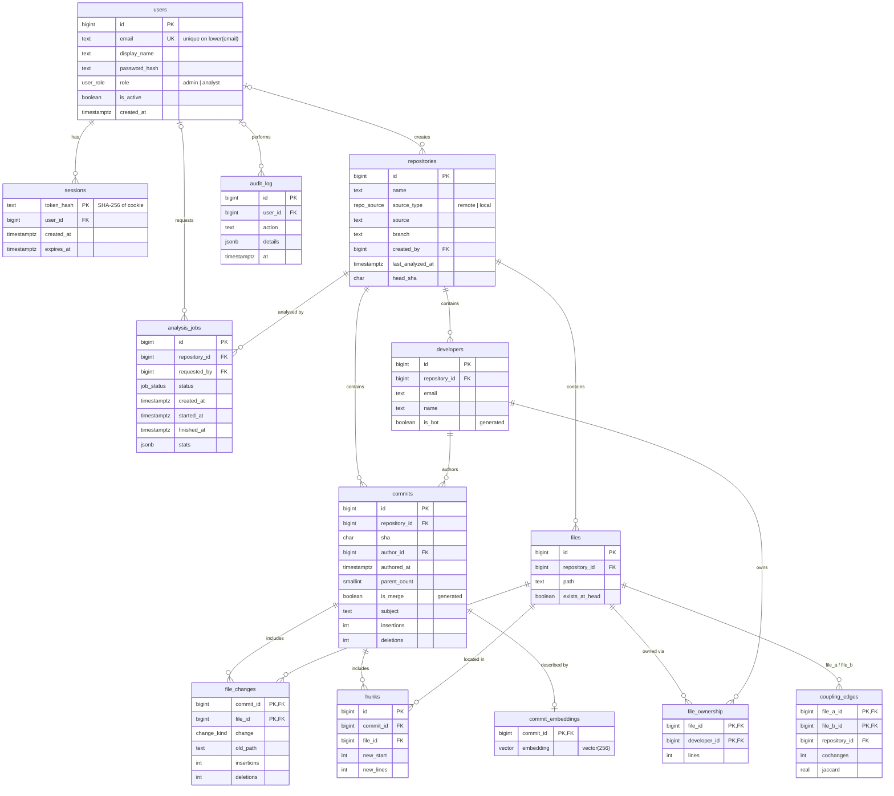

`file_changes` and `file_ownership` are **associative entities** resolving the many-to-many relationships *commit ↔ file* and *developer ↔ file*. `coupling_edges` is a recursive many-to-many relationship on `files`.

## 8. Relational schema

Primary keys are **bold**, foreign keys are *italic* with their target.

- users(**id**, email, display_name, password_hash, role, is_active, created_at)
- sessions(**token_hash**, *user_id* → users, created_at, expires_at)
- repositories(**id**, name, source_type, source, branch, *created_by* → users, created_at, updated_at, last_analyzed_at, head_sha)
- analysis_jobs(**id**, *repository_id* → repositories, *requested_by* → users, status, created_at, started_at, finished_at, worker_id, error, stats)
- developers(**id**, *repository_id* → repositories, email, name, is_bot)
- commits(**id**, *repository_id* → repositories, sha, *author_id* → developers, authored_at, committed_at, parent_count, is_merge, subject, body, files_changed, insertions, deletions)
- files(**id**, *repository_id* → repositories, path, exists_at_head)
- file_changes(***commit_id*** → commits, ***file_id*** → files, change, old_path, insertions, deletions)
- hunks(**id**, *commit_id* → commits, *file_id* → files, old_start, old_lines, new_start, new_lines)
- coupling_edges(*repository_id* → repositories, ***file_a_id*** → files, ***file_b_id*** → files, cochanges, confidence_ab, confidence_ba, jaccard)
- file_ownership(***file_id*** → files, ***developer_id*** → developers, lines)
- commit_embeddings(***commit_id*** → commits, embedding)
- audit_log(**id**, *user_id* → users, action, target_type, target_id, details, at)

**Normalisation.** The schema is in third normal form: every non-key attribute depends on the whole key and nothing but the key. Aggregates (revisions per file, commits per developer, …) are not stored but computed by views. Three deliberate, documented exceptions exist for performance and are written in the same transaction as their sources: per-commit totals on `commits`, `coupling_edges` (quadratic to recompute) and the `monthly_activity` materialised view.

## 9. Data dictionary

Types are PostgreSQL types. *Enum* types: `user_role` = {admin, analyst}; `repo_source` = {remote, local}; `job_status` = {queued, running, succeeded, failed, cancelled}; `change_kind` = {A added, M modified, D deleted, R renamed, C copied, T type changed}.

### users
| Column | Type | Null | Constraints / default | Meaning |
|---|---|---|---|---|
| id | bigint | no | PK, identity | User id |
| email | text | no | CHECK e-mail format; UNIQUE on `lower(email)` | Sign-in e-mail |
| display_name | text | no | CHECK length 1–100 | Name shown in the UI |
| password_hash | text | no | | bcrypt hash (cost 12), never the password |
| role | user_role | no | default `analyst` | Authorisation role |
| is_active | boolean | no | default true | Deactivated users cannot sign in |
| created_at | timestamptz | no | default now() | Registration time |

### sessions
| Column | Type | Null | Constraints / default | Meaning |
|---|---|---|---|---|
| token_hash | text | no | PK | SHA-256 of the session cookie token |
| user_id | bigint | no | FK → users, ON DELETE CASCADE | Owner |
| created_at | timestamptz | no | default now() | |
| expires_at | timestamptz | no | CHECK `expires_at > created_at` | Expiry |

### repositories
| Column | Type | Null | Constraints / default | Meaning |
|---|---|---|---|---|
| id | bigint | no | PK | |
| name | text | no | CHECK length 1–200 | Display name |
| source_type | repo_source | no | | Remote URL or local folder |
| source | text | no | UNIQUE (source_type, source); CHECK remote ⇒ `https://` | Normalised URL or folder name |
| branch | text | yes | | Branch to analyse (default branch if NULL) |
| created_by | bigint | yes | FK → users, ON DELETE SET NULL | Who registered it |
| created_at / updated_at | timestamptz | no | default now(); `updated_at` maintained by trigger | |
| last_analyzed_at | timestamptz | yes | set by trigger when a job succeeds | |
| head_sha | char(40) | yes | | Commit analysed most recently |

### analysis_jobs
| Column | Type | Null | Constraints / default | Meaning |
|---|---|---|---|---|
| id | bigint | no | PK | |
| repository_id | bigint | no | FK → repositories, CASCADE; partial UNIQUE while queued/running | |
| requested_by | bigint | yes | FK → users, SET NULL | |
| status | job_status | no | default `queued` | |
| created_at, started_at, finished_at | timestamptz | — | CHECKs: started ≥ created, finished ≥ started, running ⇒ started, active ⇒ not finished | Lifecycle |
| worker_id | text | yes | | Worker that claimed it |
| error | text | yes | | Failure message |
| stats | jsonb | yes | | Counts and timings of a finished analysis |

### developers
| Column | Type | Null | Constraints / default | Meaning |
|---|---|---|---|---|
| id | bigint | no | PK | |
| repository_id | bigint | no | FK → repositories, CASCADE; UNIQUE (repository_id, email) | |
| email | text | no | | Lower-cased e-mail (after `.mailmap`) |
| name | text | no | | Author name |
| is_bot | boolean | — | GENERATED ALWAYS from e-mail/name (migration 002) | Dependabot, Renovate, … |

### commits
| Column | Type | Null | Constraints / default | Meaning |
|---|---|---|---|---|
| id | bigint | no | PK | |
| repository_id | bigint | no | FK → repositories, CASCADE; UNIQUE (repository_id, sha) | |
| sha | char(40) | no | CHECK `^[0-9a-f]{40}$` | Commit hash |
| author_id | bigint | no | FK → developers, CASCADE | |
| authored_at, committed_at | timestamptz | no | | |
| parent_count | smallint | no | CHECK ≥ 0 | |
| is_merge | boolean | — | GENERATED ALWAYS AS (parent_count > 1) | |
| subject, body | text | no | body default '' | Commit message |
| files_changed, insertions, deletions | integer | no | CHECK ≥ 0, default 0 | Per-commit totals |

### files
| Column | Type | Null | Constraints / default | Meaning |
|---|---|---|---|---|
| id | bigint | no | PK | |
| repository_id | bigint | no | FK → repositories, CASCADE; UNIQUE (repository_id, path) | |
| path | text | no | | Path in the repository |
| exists_at_head | boolean | no | default false | Whether the file still exists |

### file_changes
| Column | Type | Null | Constraints / default | Meaning |
|---|---|---|---|---|
| commit_id | bigint | no | PK part; FK → commits, CASCADE | |
| file_id | bigint | no | PK part; FK → files, CASCADE | |
| change | change_kind | no | | Kind of change |
| old_path | text | yes | CHECK rename/copy ⇒ NOT NULL | Previous path |
| insertions, deletions | integer | yes | CHECK ≥ 0; NULL for binary files | Lines |

### hunks
| Column | Type | Null | Constraints / default | Meaning |
|---|---|---|---|---|
| id | bigint | no | PK | |
| commit_id / file_id | bigint | no | FK, CASCADE | |
| old_start, old_lines, new_start, new_lines | integer | no | CHECK ≥ 0 | Line range of the change |

### coupling_edges
| Column | Type | Null | Constraints / default | Meaning |
|---|---|---|---|---|
| repository_id | bigint | no | FK → repositories, CASCADE | |
| file_a_id, file_b_id | bigint | no | PK (file_a_id, file_b_id); FK → files; CHECK file_a_id < file_b_id | Undirected pair, stored once |
| cochanges | integer | no | CHECK > 0 | Commits touching both |
| confidence_ab, confidence_ba, jaccard | real | no | CHECK between 0 and 1 | Coupling strength |

### file_ownership
| Column | Type | Null | Constraints / default | Meaning |
|---|---|---|---|---|
| file_id, developer_id | bigint | no | PK; FKs, CASCADE | |
| lines | integer | no | CHECK > 0 | Lines attributed by `git blame` at HEAD |

### commit_embeddings
| Column | Type | Null | Constraints / default | Meaning |
|---|---|---|---|---|
| commit_id | bigint | no | PK; FK → commits, CASCADE | |
| embedding | vector(256) | no | HNSW index, cosine | Message embedding |

### audit_log
| Column | Type | Null | Constraints / default | Meaning |
|---|---|---|---|---|
| id | bigint | no | PK | |
| user_id | bigint | yes | FK → users, SET NULL | Actor (NULL for failed logins) |
| action | text | no | CHECK snake_case (migration 002) | e.g. `login`, `repository_created` |
| target_type, target_id | text, bigint | yes | | What was acted on |
| details | jsonb | no | default `{}` | Extra context |
| at | timestamptz | no | default now() | |

## 10. SQL implementation (DDL)

The schema is created and evolved by versioned migration files in `db/migrations`, each applied once, in order, inside a transaction (`lib/migrate.ts`, recorded in `schema_migrations`).

| File | Statements |
|---|---|
| `001_schema.sql` | `CREATE EXTENSION`, `CREATE TYPE` (4 enums), `CREATE TABLE` (13 tables with PKs, FKs, UNIQUE, CHECK, generated column), `CREATE INDEX` (B-tree, partial, expression, GIN, HNSW), `CREATE FUNCTION` + `CREATE TRIGGER` (3), `CREATE VIEW` (2), `CREATE MATERIALIZED VIEW`, `CREATE FUNCTION bus_factor` |
| `002_team_analytics.sql` | `ALTER TABLE … ADD COLUMN … GENERATED`, `ALTER TABLE … ADD CONSTRAINT … CHECK`, `DROP INDEX` + `CREATE INDEX`, `DROP VIEW` + `CREATE VIEW`, `CREATE PROCEDURE` |
| `scripts/reset-dev-db.ts` | `DROP DATABASE … WITH (FORCE)`, `CREATE DATABASE` |

Examples from `002_team_analytics.sql`:

```sql
-- ALTER: a stored generated column that flags bot accounts
ALTER TABLE developers
    ADD COLUMN is_bot BOOLEAN GENERATED ALWAYS AS (
        email ~* '(\[bot\]@|^bot@|dependabot|renovate|github-actions)'
        OR name ~* '\[bot\]$'
    ) STORED;

-- ALTER: a new CHECK constraint
ALTER TABLE audit_log
    ADD CONSTRAINT audit_log_action_format CHECK (action ~ '^[a-z][a-z_]{1,62}$');

-- DROP + CREATE: replace a single-column index with a composite one
DROP INDEX commits_author_idx;
CREATE INDEX commits_author_time_idx ON commits (author_id, authored_at DESC);

-- DROP + CREATE: redefine a view so it ignores bots
DROP VIEW file_hotspots;
CREATE VIEW file_hotspots AS ... JOIN developers d ON d.id = c.author_id ...
    count(DISTINCT c.author_id) FILTER (WHERE NOT d.is_bot) AS authors ...;
```

## 11. Database operations (DML) and important queries

All queries live in `lib/queries.ts`, the API route handlers, `lib/auth.ts` and `lib/analysis/pipeline.ts`. Every value is a bound parameter (`$1`, `$2`, …).

| Operation | Where it is used |
|---|---|
| **INSERT** | Register user (`INSERT … ON CONFLICT DO NOTHING RETURNING`), create session, register repository and queue job (one transaction), audit log, bulk insert of mined data (`INSERT … SELECT FROM unnest(…)`) |
| **UPDATE** | Claim and finish jobs, cancel a job, change a user's role / active flag, trigger-maintained `updated_at` / `last_analyzed_at` |
| **DELETE** | Sign out, delete a repository (cascades), purge expired sessions (stored procedure), delete previous results before re-analysis |
| **SELECT** | Every page and report |

### Q1. Claim the next job (subquery, row locking, transaction)
```sql
UPDATE analysis_jobs SET status = 'running', started_at = now(), worker_id = $1
 WHERE id = (SELECT id FROM analysis_jobs
              WHERE status = 'queued'
              ORDER BY created_at
              FOR UPDATE SKIP LOCKED
              LIMIT 1)
RETURNING id, repository_id;
```
Several workers can poll at once; each job is taken by exactly one, and none blocks the others.

### Q2. Core contributors (GROUP BY, HAVING, aggregate, subquery, CTE)
```sql
WITH human AS (
  SELECT c.author_id FROM commits c JOIN developers d ON d.id = c.author_id
   WHERE c.repository_id = $1 AND NOT d.is_bot
), average AS (
  SELECT avg(n)::float AS avg_commits
    FROM (SELECT count(*) AS n FROM human GROUP BY author_id) per_dev
)
SELECT d.id, d.name, d.email,
       count(*)                                         AS commits,
       count(*)::float / (SELECT count(*) FROM human)   AS share,
       a.avg_commits
  FROM human h
  JOIN developers d ON d.id = h.author_id
 CROSS JOIN average a
 GROUP BY d.id, a.avg_commits
HAVING count(*) >= a.avg_commits
 ORDER BY commits DESC, d.name;
```

### Q3. Shared files (JOIN ×3, GROUP BY, HAVING, ORDER BY)
```sql
SELECT f.id, f.path,
       count(DISTINCT c.author_id)                     AS authors,
       count(*)                                        AS revisions,
       COALESCE(sum(fc.insertions + fc.deletions), 0)  AS churn
  FROM file_changes fc
  JOIN commits c    ON c.id = fc.commit_id
  JOIN developers d ON d.id = c.author_id
  JOIN files f      ON f.id = fc.file_id
 WHERE f.repository_id = $1 AND f.exists_at_head AND NOT c.is_merge AND NOT d.is_bot
 GROUP BY f.id
HAVING count(DISTINCT c.author_id) >= $2
 ORDER BY authors DESC, revisions DESC, f.path
 LIMIT 100;
```

### Q4. Hotspots (view + correlated subquery)
```sql
SELECT h.file_id, h.path, h.revisions, h.authors, h.churn, h.last_changed_at,
       (SELECT count(*) FROM coupling_edges e
         WHERE e.file_a_id = h.file_id OR e.file_b_id = h.file_id) AS coupled_files
  FROM file_hotspots h
 WHERE h.repository_id = $1 AND h.exists_at_head
 ORDER BY h.revisions DESC, h.churn DESC, h.path
 LIMIT $2;
```

### Q5. Change coupling (self-join of `files` through `coupling_edges`)
```sql
SELECT e.file_a_id, a.path AS file_a, e.file_b_id, b.path AS file_b,
       e.cochanges, e.confidence_ab, e.confidence_ba, e.jaccard
  FROM coupling_edges e
  JOIN files a ON a.id = e.file_a_id
  JOIN files b ON b.id = e.file_b_id
 WHERE e.repository_id = $1 AND e.jaccard >= $2
   AND a.exists_at_head AND b.exists_at_head
 ORDER BY e.jaccard DESC, e.cochanges DESC
 LIMIT $3;
```

### Q6. Bus factor (SQL function with window functions)
```sql
CREATE FUNCTION bus_factor(p_repository_id BIGINT) RETURNS INTEGER
LANGUAGE sql STABLE AS $$
    WITH per_dev AS (
        SELECT o.developer_id, sum(o.lines) AS lines
          FROM file_ownership o JOIN files f ON f.id = o.file_id
         WHERE f.repository_id = p_repository_id
         GROUP BY o.developer_id
    ), ranked AS (
        SELECT lines,
               sum(lines) OVER (ORDER BY lines DESC, developer_id ROWS UNBOUNDED PRECEDING) AS running,
               sum(lines) OVER ()                                                          AS total
          FROM per_dev
    )
    SELECT count(*)::int FROM ranked WHERE running - lines <= total / 2.0
$$;
```

### Q7. Full-text search (GIN index, ranking, highlighting)
```sql
SELECT c.sha, c.subject,
       ts_headline('english', c.subject || ' ' || c.body, q) AS headline,
       ts_rank(to_tsvector('english', c.subject || ' ' || c.body), q) AS score
  FROM commits c, websearch_to_tsquery('english', $2) q
 WHERE c.repository_id = $1
   AND to_tsvector('english', c.subject || ' ' || c.body) @@ q
 ORDER BY score DESC;
```

### Q8. Vector similarity search — see [section 13](#13-vector-database-and-semantic-search).

## 12. Advanced database features

| Feature | Implementation |
|---|---|
| **Transactions** | Each analysis deletes old results and bulk-inserts new ones in one transaction (readers see old or new, never a mix); repository registration + job creation + audit in one transaction; every migration in its own transaction. |
| **Concurrency control** | `FOR UPDATE SKIP LOCKED` job queue (Q1); partial unique index allowing one active job per repository; `ON CONFLICT DO NOTHING` for race-free registration. |
| **Views** | `developer_activity`, `file_hotspots`. |
| **Materialised view** | `monthly_activity`, refreshed `CONCURRENTLY` after each analysis (needs its unique index). |
| **Stored function** | `bus_factor(repository_id)` (Q6). |
| **Stored procedure** | `purge_expired_sessions(INOUT removed)`, called with `CALL` on every sign-in. |
| **Triggers** | `protect_last_admin` (BEFORE UPDATE/DELETE on users), `touch_updated_at` (BEFORE UPDATE on repositories), `stamp_repository_analyzed` (AFTER UPDATE OF status on analysis_jobs). |
| **Indexing** | B-tree, composite, partial (`WHERE status = 'queued'`), expression (`lower(email)`), GIN full-text, HNSW vector; see `docs/database-design.md`. |
| **Generated columns** | `commits.is_merge`, `developers.is_bot`. |
| **Full-text search** | `tsvector` / `websearch_to_tsquery` / `ts_rank` / `ts_headline` (Q7). |
| **Vector similarity search** | pgvector HNSW, cosine distance (section 13). |
| **NoSQL graph traversal** | Neo4j Cypher queries (section 14). |

## 13. Vector database and semantic search

| Question | Answer |
|---|---|
| **What is embedded?** | The message of every commit (subject and body). |
| **Embedding approach** | A deterministic *feature-hashing* embedding (`lib/analysis/embedding.ts`): the text is lower-cased and tokenised, stop-words are dropped, and every word and adjacent word pair (bigram) is hashed into one of 256 dimensions with a pseudo-random sign. The vector is then L2-normalised. It needs no model download or external API, works offline, and gives the same vector for the same text every time. |
| **How vectors are stored** | Table `commit_embeddings(commit_id PK → commits, embedding vector(256))`, written in the same transaction as the commits and deleted with them by `ON DELETE CASCADE`. |
| **Index** | `CREATE INDEX … USING hnsw (embedding vector_cosine_ops)`: approximate nearest-neighbour search. |
| **Similarity metric** | Cosine distance, operator `<=>`; the UI shows similarity = 1 − distance. |
| **Retrieval** | The search text is embedded with the same function, then: |

```sql
SELECT c.sha, c.subject, d.name AS author,
       1 - (e.embedding <=> $2::vector) AS score
  FROM commit_embeddings e
  JOIN commits c    ON c.id = e.commit_id
  JOIN developers d ON d.id = c.author_id
 WHERE c.repository_id = $1
 ORDER BY e.embedding <=> $2::vector
 LIMIT 15;
```

Full-text search finds commits containing the *words* typed; vector search also finds commits with *similar wording* (shared words and word pairs in a different form or order), as the screenshots in section 16 show.

## 14. NoSQL graph model (Neo4j)

**Data model**

```
(:Repository {id, name})
(:Developer {id, repoId, name, email})-[:IN_REPO]->(:Repository)
(:File {id, repoId, path, alive})-[:IN_REPO]->(:Repository)
(:Developer)-[:TOUCHED {commits, churn}]->(:File)
(:Developer)-[:OWNS {lines}]->(:File)
(:File)-[:COUPLED_WITH {cochanges, jaccard}]->(:File)
```

**Indexes / constraints** (created by `npm run neo4j:init`): uniqueness constraints on `Repository.id`, `Developer.id` and `File.id`, and indexes on `repoId`.

**Retrieval strategy.** After each successful analysis the worker rebuilds the repository's subgraph from PostgreSQL in batches (`lib/graph/projection.ts`). Queries:

- **Reviewer suggestions** for a file: developers who touched the file or its coupled files, scored by `commits × jaccard`:
  ```cypher
  MATCH (f:File {id: $fileId})
  OPTIONAL MATCH (f)-[c:COUPLED_WITH]-(g:File)
  WITH f, collect({file: g, w: c.jaccard}) AS neighbours
  UNWIND [{file: f, w: 1.0}] + [n IN neighbours WHERE n.file IS NOT NULL] AS target
  WITH target.file AS file, target.w AS w
  MATCH (d:Developer)-[t:TOUCHED]->(file)
  RETURN d.name, sum(t.commits * w) AS score ORDER BY score DESC LIMIT 8
  ```
- **Collaboration** (aggregation over a two-hop pattern): developer pairs sharing files, `count(DISTINCT f)`.
- **Knowledge silos**: files where one developer owns at least 90% of the lines.

If Neo4j is unavailable the analysis still succeeds; only the graph views are affected.

## 15. Data validation, integrity and security

**At the database level**
- NOT NULL, UNIQUE, CHECK (formats, ranges, ordering, cross-column rules) and FOREIGN KEY constraints with deliberate `CASCADE` / `SET NULL` actions.
- Enum types restrict roles, job states and change kinds.
- Trigger `protect_last_admin` guarantees at least one active administrator.
- Partial unique index guarantees at most one active analysis per repository.

**At the application level**
- Every request body is validated with Zod; remote URLs must be plain `https` on an allow-listed host (no credentials, ports, IP literals or query strings); local paths are resolved with `realpath` and must stay inside the configured root; branch names are validated before reaching git.
- Every SQL value is a bound parameter.

**Security**
- Passwords are hashed with bcrypt (cost 12); session tokens are random 256-bit values and only their SHA-256 is stored; cookies are `HttpOnly` and `SameSite=Lax`; mutating API calls are origin-checked.
- Database and service credentials come only from environment variables (`.env.local`, git-ignored).
- Sign-in and registration are rate-limited per IP and per account; failed sign-ins are written to the audit log.
- Role-based access: analysts can analyse and view; only administrators can manage users or delete other people's repositories.

## 16. Application screenshots

Captured from the running application after analysing the public repository `expressjs/cors` (351 commits, 62 developers).

**Sign in**
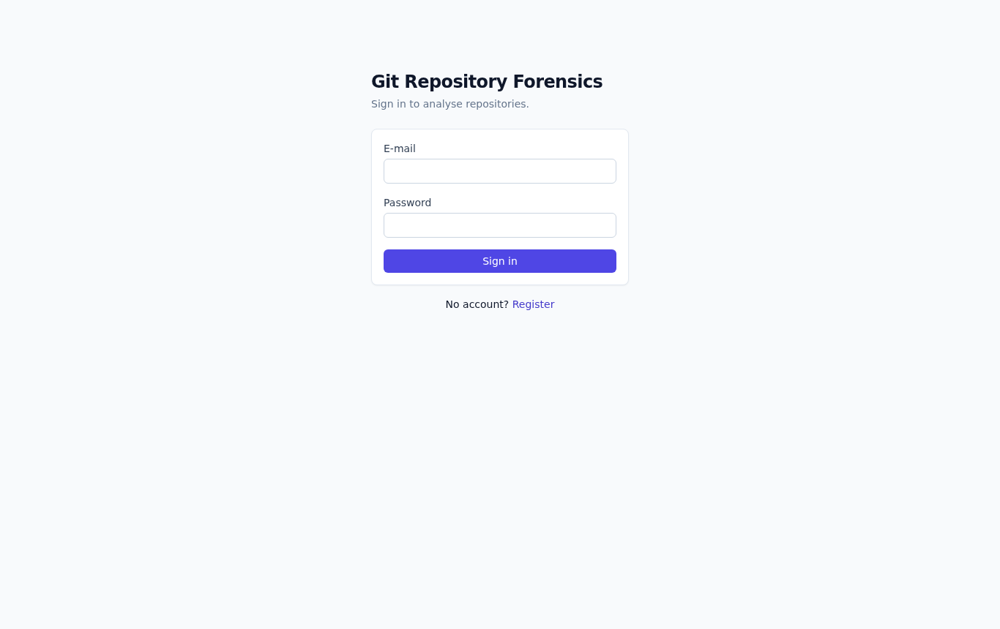

**Repositories**: register a repository, see analysis status
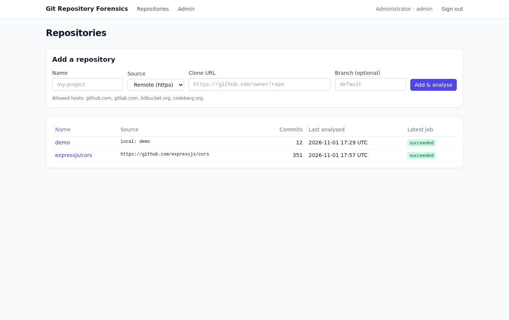

**Overview**: summary cards, bus factor, monthly activity (materialised view), top hotspots
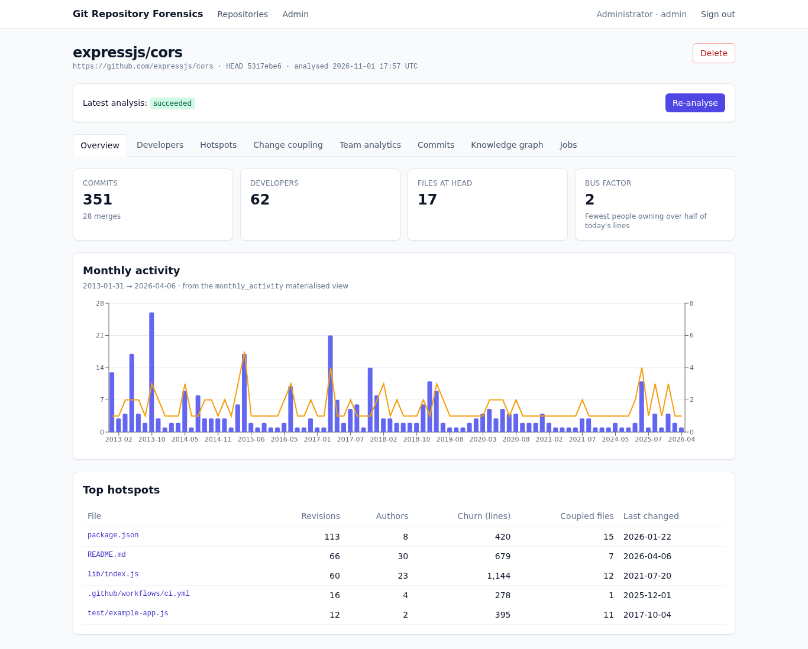

**Developers**: per-developer activity and ownership
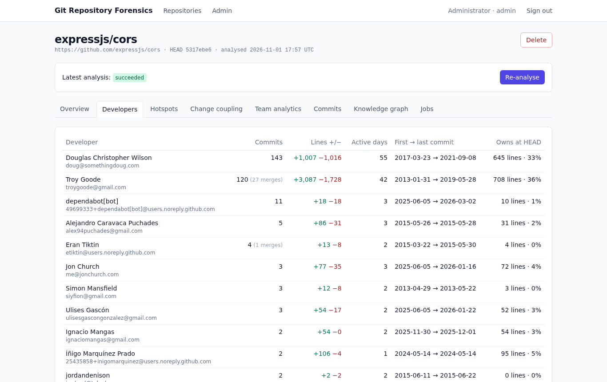

**Hotspots**
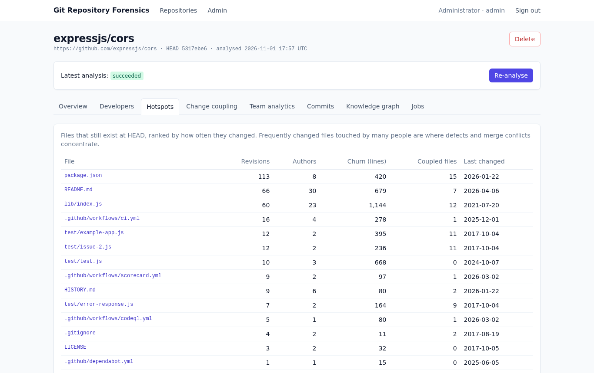

**Change coupling**: filtered by minimum Jaccard
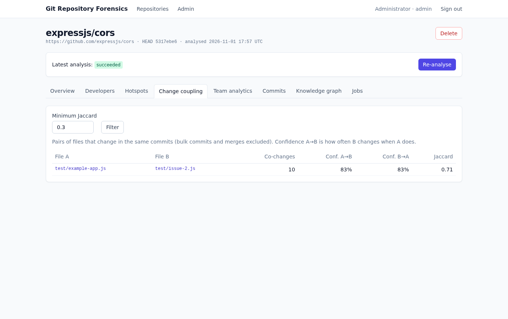

**Team analytics**: core contributors and shared files (`GROUP BY … HAVING`)
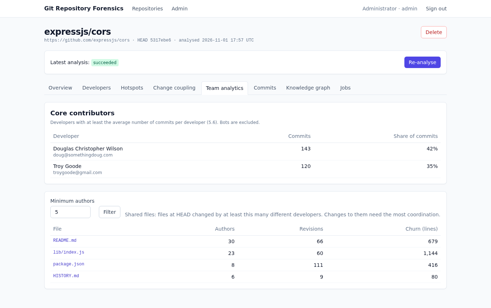

**Full-text search** (`tsvector`, ranked and highlighted)
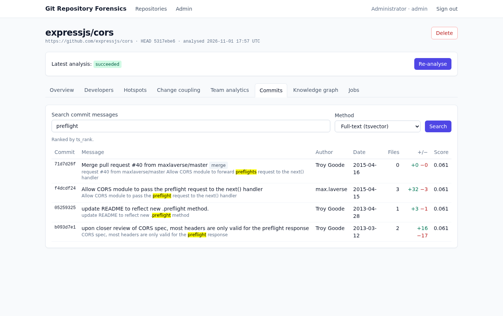

**Semantic search** (pgvector cosine similarity)
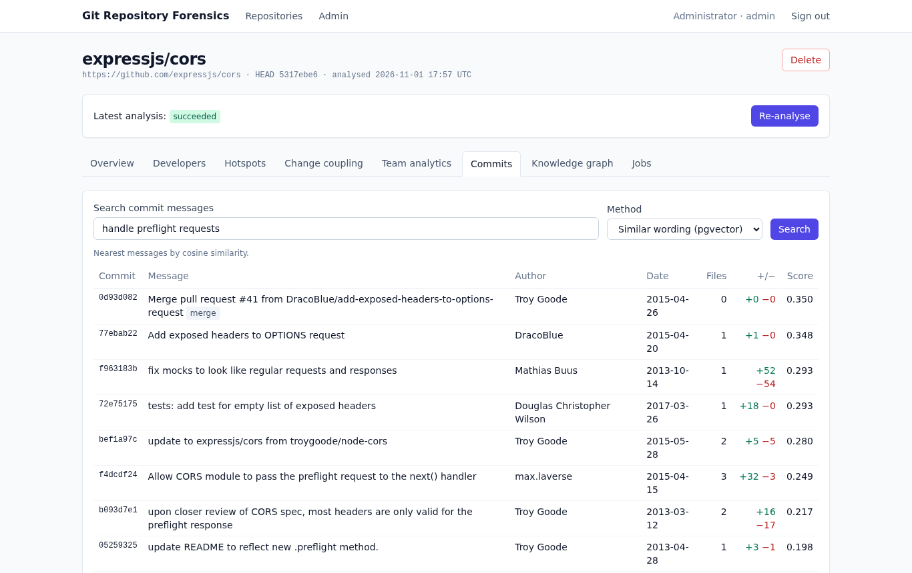

**Knowledge graph** (Neo4j): collaboration pairs and knowledge silos
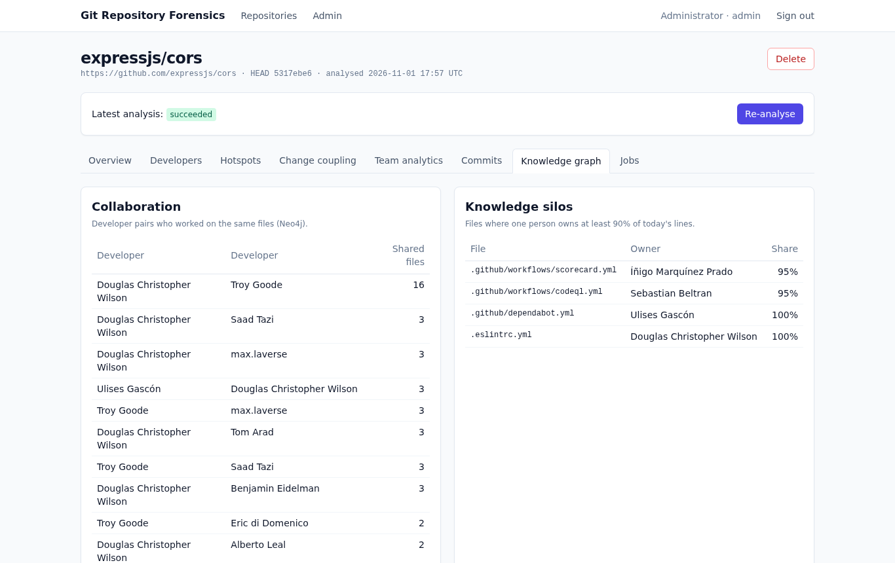

**File detail**: history, owners, coupled files, change heat-map, suggested reviewers
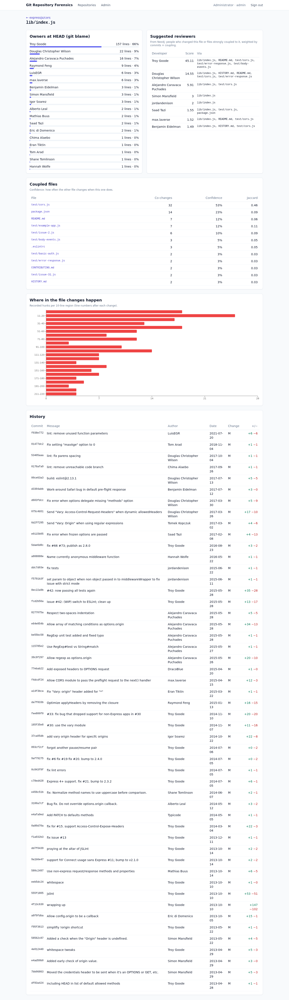

**Analysis jobs**
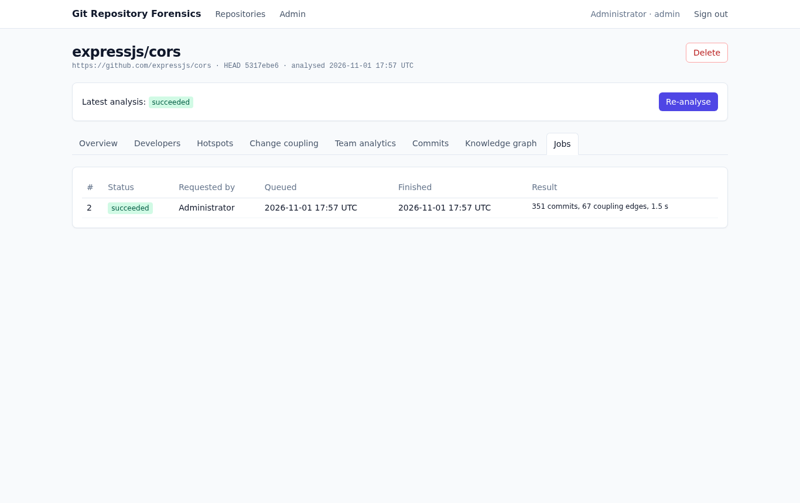

**Administration**: users, roles and the audit log
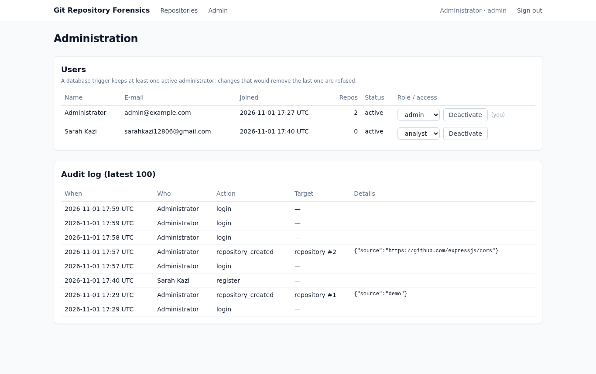

## 17. Testing results

Tests use Vitest. Run them with `make test` (or `npm run db:reset -- --test && npm test`).

- **Unit tests** (no database): git output parsers, run both on synthetic output and on a real repository built by `scripts/fixture-repo.ts`; the change-coupling algorithm; the embedding; URL, path and branch validation (including path-traversal, SSRF and option-injection attempts).
- **Integration tests** (real PostgreSQL + pgvector): run the whole analysis pipeline on the fixture repository and compare stored results with values known in advance, then check the schema rules.

**Result: 4 test files, 58 tests, all passed.**

| Suite | Tests | Result |
|---|---|---|
| `tests/integration/pipeline.test.ts` | 8 | ✅ passed |
| `tests/unit/git-parse.test.ts` | 10 | ✅ passed |
| `tests/unit/analysis.test.ts` | 9 | ✅ passed |
| `tests/unit/repo-source.test.ts` | 31 | ✅ passed |

Integration test cases:

| # | Test case | Checks |
|---|---|---|
| 1 | Stores commits, developers, files and changes | 12 commits, 1 merge, 3 developers, rename detected (`src/db.ts → src/database.ts`), binary file has NULL line counts, deleted file not at HEAD |
| 2 | Computes change coupling | `api.ts ↔ api.test.ts`: 3 co-changes, Jaccard = 3/5; bulk commit excluded |
| 3 | Ownership, bus factor and views | Blame totals, `bus_factor()` in range, top hotspot `src/api.ts`, materialised view count |
| 4 | Full-text and vector search | FTS finds "Rename db module to database" for *renaming database*; nearest vector to *put endpoint API test* is "Add put endpoint to API with test" |
| 5 | GROUP BY … HAVING, ignoring bots | Core contributors = Alice (5) and Bob (4), average 4; shared files with ≥ 3 authors starts with `src/api.ts`; a bot with 20 commits is flagged by `is_bot` and changes neither report |
| 6 | Schema change 002 | New CHECK rejects a bad audit action (SQLSTATE 23514); old index dropped, composite index present; `CALL purge_expired_sessions()` removes exactly the expired session |
| 7 | Re-analysis | Data replaced, not duplicated |
| 8 | Business rules | Second active job rejected (23505); unordered coupling pair rejected (23514); last admin cannot be demoted (trigger); case-insensitive duplicate e-mail rejected (23505); deleting a repository cascades to all mined rows |

Output of `vitest run --reporter=verbose` (abridged to the integration suite and totals):

```
 ✓ tests/integration/pipeline.test.ts > analysis pipeline (PostgreSQL) > stores commits, developers, files and changes
 ✓ tests/integration/pipeline.test.ts > analysis pipeline (PostgreSQL) > computes change coupling with the expected metrics, excluding the bulk commit
 ✓ tests/integration/pipeline.test.ts > analysis pipeline (PostgreSQL) > computes ownership, the bus factor and the reporting views
 ✓ tests/integration/pipeline.test.ts > analysis pipeline (PostgreSQL) > supports full-text and vector search over commit messages
 ✓ tests/integration/pipeline.test.ts > analysis pipeline (PostgreSQL) > finds core contributors and shared files with GROUP BY … HAVING, ignoring bots
 ✓ tests/integration/pipeline.test.ts > analysis pipeline (PostgreSQL) > applies schema change 002: ALTER constraints, replaced index and the stored procedure
 ✓ tests/integration/pipeline.test.ts > analysis pipeline (PostgreSQL) > replaces, rather than duplicates, data on re-analysis
 ✓ tests/integration/pipeline.test.ts > analysis pipeline (PostgreSQL) > enforces the schema's business rules
 ...
 Test Files  4 passed (4)
      Tests  58 passed (58)
```

The application was also tested end to end: sign-in, repository registration, background analysis of the fixture repository and of `expressjs/cors`, every report endpoint, input validation errors (HTTP 400), the cross-origin check (requests without a matching `Origin` are rejected) and role-restricted pages.

## 18. Team contributions

| Member | Responsibilities |
|---|---|
| Krishitha Kankanala (PES2UG24CS234) | _To be completed by the team._ |
| Sarah Kazi (PES2UG24CS224) | _To be completed by the team._ |

The Git history of the repository records the individual commits of each member.

## 19. Conclusion and future enhancements

**Conclusion.** Git Repository Forensics shows how a database turns a raw activity log into decisions. PostgreSQL holds the history in a normalised schema whose constraints, triggers and transactions keep it consistent; views, a materialised view, a function, window functions and `GROUP BY … HAVING` queries derive the metrics; pgvector adds semantic search over commit messages inside the same transactions; and Neo4j answers multi-hop questions about people and files that are awkward in SQL. Each technology was chosen for the shape of the data it holds, and the web application exposes all of it securely with two roles.

**Future enhancements**

1. **Learned embeddings**: replace feature hashing with a sentence-embedding model for true semantic search (a column change to `vector(384)` and a re-index).
2. **Incremental analysis**: process only commits added since `head_sha` instead of re-mining the full history.
3. **Private repositories** through per-user, encrypted deploy keys.
4. **Webhooks** so pushes trigger re-analysis automatically.
5. **Time-windowed metrics**: hotspots and coupling over the last *N* months, to separate current risk from old history.
6. **Pull-request data** (review times, reviewers) to validate the reviewer suggestions against who actually reviewed.
7. **Table partitioning** of `commits` and `file_changes` by repository for very large installations.
